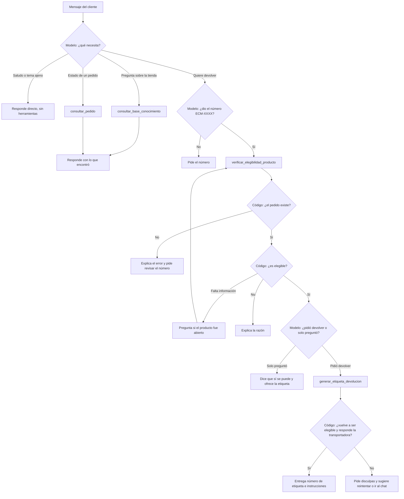
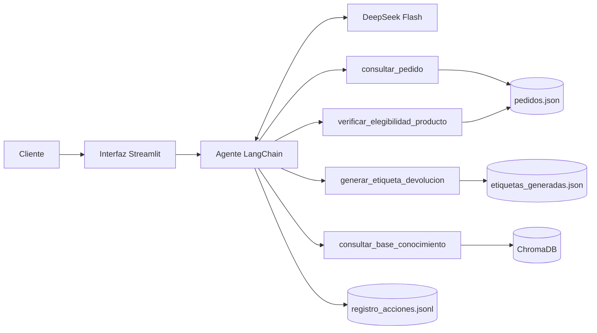

# Fase 1: Diseño de la arquitectura del agente

## Qué cambia respecto al Taller 2

En el Taller 2 el asistente solo podía **responder**. Si un cliente quería devolver un producto, le explicaba los pasos y el cliente tenía que hacerlos solo.

Ahora el asistente es un **agente**: además de responder, puede **hacer acciones**. Para la devolución verifica si el pedido cumple la política y genera la etiqueta de envío.

La diferencia técnica es esta:

- **Taller 2:** nuestro código buscaba documentos, los ponía en el prompt y el modelo escribía la respuesta. El camino era siempre el mismo.
- **Proyecto final:** el modelo recibe una lista de herramientas y decide cuáles usar según el mensaje. Si no necesita ninguna, responde directo.

---

## 1. Extensión de la arquitectura RAG

El enunciado da dos opciones para conectar el RAG con el agente:

| | RAG como herramienta | RAG como ruta alterna (router) |
|---|---|---|
| Cómo funciona | El RAG es una herramienta más. El modelo decide cuándo usarla. | Una regla revisa el mensaje antes del agente. Si es una pregunta general va al RAG; si es una devolución va al agente. |
| Ventaja | Un mensaje puede usar RAG y herramientas al mismo tiempo. Solo hay un flujo. | Gasta menos en preguntas simples. El camino es más predecible. |
| Desventaja | Cada pregunta del RAG usa dos llamadas al modelo: una para decidir y otra para responder. | Hay que escribir y mantener las reglas. Un mensaje con dos temas va solo por una ruta. |

**Elegimos RAG como herramienta.** La razón principal es que un mensaje real puede mezclar temas. Probamos el caso "Quiero devolver mi pedido ECM-1005. ¿En cuánto tiempo me devuelven la plata si pagué con PSE?": el agente verificó el pedido y consultó la política en la misma respuesta. Con un router ese mensaje habría ido a una sola ruta.

Aceptamos el costo extra porque es bajo. Las 18 pruebas de la evaluación costaron unos 0.02 USD en total (ver la Fase 2).

Para consultar pedidos y verificar la elegibilidad **no** usamos el RAG. Son datos exactos y reglas fijas, y una búsqueda por similitud trae "lo más parecido", no lo exacto.

---

## 2. Definición de las herramientas

El agente tiene 4 herramientas: 3 nuevas y el RAG. El enunciado pide mínimo 2 sin contar el RAG.

Todas son funciones simuladas: no se conectan a sistemas reales de EcoMarket. Leen archivos locales y siempre devuelven un diccionario con el campo `ok`. Si algo sale mal devuelven `ok: false`, un `codigo` y un `mensaje`. Nunca lanzan una excepción, para que el modelo siempre reciba algo que pueda explicarle al cliente.

### `consultar_pedido`

Sistema que simula: sistema de pedidos.

| | |
|---|---|
| **Recibe** | `tracking_number` (texto, ej. `ECM-1004`) |
| **Devuelve si funciona** | `ok: true`, cliente, producto, estado, fechas, ciudad y detalle |
| **Errores** | `formato_invalido`, `pedido_no_encontrado` |

### `verificar_elegibilidad_producto`

Sistema que simula: motor de reglas de la política de devoluciones.

| | |
|---|---|
| **Recibe** | `tracking_number`; `motivo` (`producto_danado`, `producto_vencido`, `producto_equivocado` u `otro`); `producto_abierto` (opcional: `true` o `false`) |
| **Devuelve si es elegible** | `ok: true`, `elegible: true`, `tipo` (`devolucion_normal` o `producto_defectuoso`), `requiere_foto` |
| **Devuelve si no es elegible** | `ok: true`, `elegible: false`, `codigo` y `mensaje` con la razón |
| **Razones de no elegible** | `no_entregado`, `ya_devuelto`, `pedido_cancelado`, `perecedero`, `higiene_abierto`, `fuera_de_plazo`, `no_devolvible`, `falta_informacion` |
| **Errores** | `formato_invalido`, `pedido_no_encontrado`, `motivo_invalido` |

**Esta herramienta decide con código, no con el modelo.** En el Taller 1 un modelo inventó un dato y negó una devolución válida. En el Taller 2, en el caso de los snacks vencidos, la búsqueda no trajo la sección 6 y el modelo no pudo dar la solución. Las reglas de la política (30 días, perecederos, higiene, 5 días para defectos) ahora están escritas en Python, así que dan siempre el mismo resultado.

`elegible: false` no es un error: la herramienta funcionó y la respuesta es "no". Por eso va con `ok: true`.

### `generar_etiqueta_devolucion`

Sistema que simula: API de la transportadora.

| | |
|---|---|
| **Recibe** | `tracking_number`, `motivo`, `producto_abierto` (opcional) |
| **Devuelve si funciona** | `ok: true`, `numero_etiqueta` (ej. `RMA-1005`), producto, transportadora, instrucciones, `ya_existia` |
| **Errores** | Los códigos de no elegible, `servicio_no_disponible` (la transportadora no responde) |

Tiene dos protecciones:

- **Vuelve a verificar la elegibilidad.** Aunque el modelo se equivoque o un cliente lo engañe, la función no crea la etiqueta si el pedido no cumple.
- **No duplica.** Si el pedido ya tiene etiqueta, devuelve la misma con `ya_existia: true`.

### `consultar_base_conocimiento` (el RAG del Taller 2)

| | |
|---|---|
| **Recibe** | `pregunta` (texto) |
| **Devuelve si funciona** | `ok: true`, `fragmentos`: los 4 fragmentos más parecidos, cada uno con su fuente |
| **Errores** | `base_no_disponible` |

Usa la misma base del Taller 2 (ChromaDB y el modelo de embeddings MiniLM multilingüe) con 39 fragmentos. Agregamos una pregunta frecuente sobre productos dañados o vencidos, que fue la corrección que propusimos en el Taller 2.

---

## 3. Selección del marco de agentes

| | **LangChain** | **LlamaIndex** |
|---|---|---|
| Fuerte en | Conectar modelos con herramientas y flujos | Indexar y consultar documentos |
| Crear una herramienta | Un decorador `@tool` sobre una función normal | También se puede, con `FunctionTool` |
| Crear el agente | `create_agent(modelo, herramientas, system_prompt=...)` | Tiene clases de agente propias |
| Nuestro caso | El código del Taller 2 ya usa LangChain | Habría que reescribir la carga de documentos, la indexación y la conexión con DeepSeek |

**Elegimos LangChain** por tres razones:

1. **Continuidad.** El enunciado pide partir del código del Taller 2, y ese código ya usa LangChain. Reutilizamos `cargar_documentos.py` e `indexar.py` sin cambiar su lógica.
2. **Facilidad de uso.** Con `@tool`, una función de Python se vuelve una herramienta. El nombre, los parámetros y la descripción que lee el modelo salen de la misma función.
3. **Integración de herramientas.** `create_agent` hace el ciclo completo: llama al modelo, ejecuta la herramienta que pidió, le devuelve el resultado y repite. Además, permite poner un límite de pasos para evitar ciclos que gasten saldo.

LlamaIndex es una buena opción cuando el centro del proyecto son los documentos. Aquí el centro es la acción de devolver, no la búsqueda, así que no vimos razón para cambiar.

**Modelo:** seguimos con DeepSeek Flash por la misma razón del Taller 2 (relación costo/calidad/beneficio). Además, soporta llamadas a herramientas con el formato de OpenAI, que es lo que necesita `ChatOpenAI`.

---

## 4. Flujo de trabajo del proceso de devolución

Los rombos con "Modelo" son decisiones del LLM. Los rombos con "Código" son decisiones fijas en Python.

El flujo no está programado paso por paso. Está descrito en el prompt de sistema (`fase2_agente/src/prompts.py`) y el modelo lo sigue. Por eso las reglas importantes también están en el código: el prompt guía al modelo, pero el código es el que impide crear una etiqueta indebida.

## Resumen de la arquitectura

